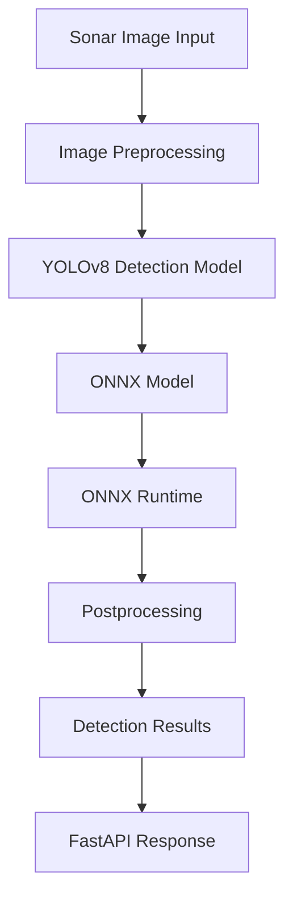

# TRINETRA: AI-Powered Underwater Debris and Anomaly Detection

## Abstract

Underwater environments are difficult to monitor because of limited visibility, complex seabed structures, and challenges associated with conventional inspection techniques. Identifying debris and unusual objects in these environments is important for underwater safety, infrastructure monitoring, and marine environmental assessment.

TRINETRA is an AI-based underwater object detection system that uses sonar imagery and deep learning techniques to identify and localize underwater objects. The system uses the YOLOv8 object detection architecture and an ONNX-based inference pipeline to analyze input imagery and generate detection results.

A FastAPI backend provides the interface for processing image inputs and delivering model predictions. The overall approach aims to reduce manual inspection effort and provide a foundation for automated underwater monitoring.

## 1. Problem Definition

Underwater debris and unidentified objects can create risks for marine ecosystems, underwater infrastructure, and human activities. Conventional underwater inspection methods often require specialized equipment and manual interpretation of collected imagery.

Sonar imaging provides a way to observe underwater environments where conventional optical imaging may be limited. However, interpreting sonar images and consistently identifying objects can be challenging.

TRINETRA addresses this problem through automated object detection on sonar imagery using deep learning.

## 2. Project Objectives

- Analyze underwater sonar imagery using deep learning.
- Detect and localize underwater objects in input images.
- Develop an automated image-based detection pipeline.
- Integrate the trained detection model with a backend API.
- Use ONNX Runtime for model inference.
- Establish a foundation for future underwater monitoring applications.

## 3. Proposed Methodology

The detection pipeline consists of the following stages:

### 3.1 Input Acquisition

The system accepts sonar imagery as input for underwater object analysis.

### 3.2 Image Preprocessing

Input images are prepared in the format required by the trained detection model. Preprocessing operations must remain consistent with the model's training configuration.

### 3.3 Object Detection

The YOLOv8 object detection architecture is used to identify and localize objects within the input imagery.

The model generates detection predictions, including object locations and confidence scores.

### 3.4 Model Inference Using ONNX Runtime

The trained model is exported to ONNX format for inference. ONNX Runtime is used to execute the exported model and obtain predictions.

### 3.5 Postprocessing

Model predictions are processed to obtain the final detection results, including bounding-box coordinates, confidence scores, and predicted class labels.

### 3.6 API Response

The FastAPI backend handles image-processing requests and provides the corresponding detection output to the client.

## 4. System Architecture



## 5. Technology Stack

| Component | Technology |
|---|---|
| Programming Language | Python |
| Object Detection | YOLOv8 |
| Model Format | ONNX |
| Inference Engine | ONNX Runtime |
| Backend Framework | FastAPI |
| ASGI Server | Uvicorn |
| Image Processing | OpenCV |
| Numerical Processing | NumPy |
| Image Handling | Pillow |
| Model Development | Google Colab |

## 6. Core System Functionality

### Sonar Image Input
Accepts sonar images for automated underwater object analysis.

### AI-Based Object Detection
Uses the trained YOLOv8 model to identify and localize objects in sonar imagery.

### Model Inference
Executes the exported ONNX model through ONNX Runtime.

### Detection Output
Processes model predictions and returns detection information such as:
- Predicted class label
- Confidence score
- Bounding-box coordinates

### Backend API
Uses FastAPI to expose the image-processing functionality through HTTP endpoints.

## 7. Project Structure

```text
TRINETRA/
│
├── backend/
│   ├── main.py
│   ├── requirements.txt
│   └── ...
│
├── model/
│   └── best.onnx
│
├── frontend/
│   └── ...
│
├── dataset/
│   └── ...
│
├── README.md
└── .gitignore
```

*The structure above is illustrative. Update it to match the actual repository.*

## 8. Installation and Setup

### Prerequisites

- Python 3.10 or a compatible version
- pip
- Git

### Clone the Repository

```bash
git clone <REPOSITORY_URL>
cd TRINETRA
```

### Create a Virtual Environment

```bash
python -m venv venv
```

Activate it on Windows:

```bash
venv\Scripts\activate
```

### Install Dependencies

```bash
pip install -r requirements.txt
```

### Start the Backend

If the FastAPI entry point is `main.py`:

```bash
uvicorn main:app --reload
```

Access the API documentation at:

```text
http://127.0.0.1:8000/docs
```

## 9. Dependencies

The backend dependency configuration includes:

```text
fastapi>=0.110.0
uvicorn[standard]>=0.28.0
ultralytics>=8.1.0
numpy>=1.24.0,<3.0.0
opencv-python-headless>=4.8.0
pillow>=10.0.0
python-multipart>=0.0.9
```

The ONNX Runtime package and other runtime-specific dependencies should also be included in the final environment configuration if required by the implementation.

## 10. Model Evaluation

Model performance should be evaluated using appropriate object detection metrics.

Recommended evaluation metrics include:

- Precision
- Recall
- F1-score
- Mean Average Precision (mAP)
- Inference time

Actual evaluation values, dataset size, class distribution, and experimental results should be reported here after verification against the training and testing results.

## 11. Limitations

- Detection performance depends on the quality and diversity of sonar imagery.
- Model predictions may be affected by noise and variations in sonar image characteristics.
- Detection reliability depends on the training dataset and model configuration.
- The system's results should be validated under different underwater imaging conditions.

## 12. Future Scope

- Integration with real-time sonar acquisition systems.
- Testing with diverse underwater environments.
- Expansion of the training dataset and detection classes.
- Optimization for edge computing platforms.
- Integration with autonomous underwater vehicles.
- Development of real-time underwater monitoring capabilities.

## 13. References

Add the actual research papers and technical documentation used during model development.

- YOLOv8 technical documentation: https://docs.ultralytics.com/
- ONNX Runtime documentation: https://onnxruntime.ai/docs/
- FastAPI documentation: https://fastapi.tiangolo.com/

